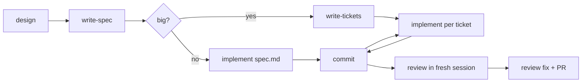
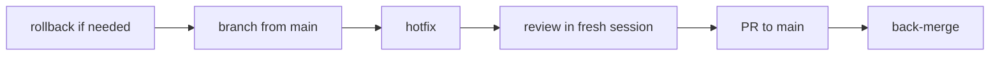

# devloop-skills

Idea to pull request in twelve skills. Brainstorm, spec, tickets, test-first build, fresh-session review, PR. Plus a hotfix flow for production bugs.

Works in any agent that supports [Agent Skills](https://agentskills.io/specification), including **Pi**, **Claude Code** and **Codex**.

## Install

```bash
npx -y skills add azmainadel/devloop-skills -g --skill '*'
```

`--skill '*'` installs all twelve without the picker. Drop `-g` to install into the current project only.

These skills may clash with similar skills you already have installed (other TDD, debugging, review or interview skills), since both compete for the same triggers. If an agent picks the wrong one, run the devloop skill by name.

Check the install with `npx skills list -g`, then look for the skills in pi (`/skill:`) or Claude Code (`/`).

## Skills

| Skill           | Runs                                       | Use for                                                                                    |
| --------------- | ------------------------------------------ | ------------------------------------------------------------------------------------------ |
| `setup`         | You, once per repo                         | Adds `## Workflow` to AGENTS.md (checks, branches, desk layout); keeps `.desk/` out of git |
| `brainstorm`    | You, or on its own when you say "grill me" | Thinking an idea through. Interview only, writes no files                                  |
| `design`        | You                                        | An idea you're going to build. Interview that also writes `CONTEXT.md` and ADRs            |
| `write-spec`    | You                                        | Writes `.desk/<branch>/spec.md`, ending in an acceptance checklist                         |
| `write-tickets` | You, optional                              | Splits the spec into `.desk/<branch>/tickets/NN-*.md`                                      |
| `implement`     | You                                        | Builds a ticket or the spec test-first, one slice at a time. Never commits                 |
| `review`        | You, in a fresh session                    | Reviews the branch diff, writes `.desk/<branch>/review.md`. `review fix` fixes it          |
| `hotfix`        | You                                        | Production bug: branch check, root cause, regression test, minimal fix                     |
| `checkpoint`    | You, when stopping mid-work                | Writes `.desk/<branch>/checkpoint.md`                                                      |
| `pickup`        | You, in a fresh session                    | Reads the checkpoint, git and ticket status; names the next step                           |
| `debug`         | On its own                                 | Root cause before any fix. Force it if the agent guesses a second fix in a row             |
| `verify`        | On its own                                 | No "done" without check output. Force it if the agent says "done" without showing output   |

## Where devloop files live

```
<your-repo>/
  AGENTS.md            ← committed; setup adds "## Workflow"
  CONTEXT.md           ← committed; design writes the glossary
  docs/adr/            ← committed; design writes decisions
  .desk/               ← never committed (listed in .git/info/exclude)
    <branch>/          ← branch name with / replaced by -, e.g. feat-team-billing
      spec.md          ← write-spec
      tickets/01-*.md  ← write-tickets (optional)
      review.md        ← review → review fix, then delete
      checkpoint.md    ← checkpoint → pickup, then deleted
      notes.md         ← hotfix notes
```

`.desk/` is local: it doesn't follow you to another machine or a fresh clone.

## Feature flow

One ticket at a time per checkout. Parallel sessions in the same folder edit the same files, run tests against each other's half-done changes, and mix up commits. Tickets are also ordered by their blockers, so the next one usually needs the last one done.



1. **Once per repo.** `/skill:setup`.
2. **Branch.** `git switch -c feat/<name>`. The desk folder is named after the branch, so branch first.
3. **Pin down the idea.** `/skill:design <idea in 2-3 lines>`. Writes `CONTEXT.md` and ADRs as decisions settle. Done when the questions run out and you confirm the summary.
4. **Spec.** `/skill:write-spec`. It confirms the test seams with you, writes `.desk/<branch>/spec.md`, and stops. Read it and fix it now.
5. **Tickets (optional).** If the work is more than about one session, `/skill:write-tickets`. Otherwise skip to step 6 with the spec.
6. **Build.**
   btw
   - When it finishes, it proposes a commit. Say "commit this". Next ticket, in a fresh session.
   - Commit after every ticket, so only one ticket is ever open.
7. **Review in a fresh session.** Start a fresh session, then `/skill:review`. It writes `.desk/<branch>/review.md` and edits no code.
   - Strike out or delete findings you disagree with (a one-line reason helps), then `/skill:review fix`.
   - Commit. Refactors come as a separate commit. Delete `review.md`.
8. **PR.** Read the diff, then say "push and open a PR" (runs `git push` + `gh pr create`).

`implement` never commits, pushes or opens PRs. You ask for each.

Just thinking, not building? `/skill:brainstorm <idea>`. Same interview, no files.

## Hotfix flow

For a bug in production. No design, spec or tickets: you're finding a cause, not designing.



1. **Stop the bleeding.** Users blocked and cause unknown? Roll back the last deploy first. Your call, not the agent's.
2. **Branch from main.** `git switch main && git pull && git switch -c hotfix/<bug>`. Not develop; it holds unreleased work.
3. **Fix.** Fresh session: `/skill:hotfix <what users see + error + logs>`. Paste real production logs. It checks the branch, finds the root cause (using `debug`), writes a regression test that fails on the bug, applies the smallest fix with no refactors, and proposes a commit.
4. **Review.** Fresh session, `/skill:review`, then `/skill:review fix`.
5. **Ship.** PR to main, deploy, confirm the error is gone from the logs.
6. **Back-merge.** Merge main into staging and develop, or the next release brings the bug back.

## Guards (not steps)

These load on their own. You only force them when the agent skips them.

| Guard    | Kicks in when                                                          | Force it if                                 | Command                             |
| -------- | ---------------------------------------------------------------------- | ------------------------------------------- | ----------------------------------- |
| `debug`  | A test fails for an unexpected reason, or a bug shows up outside tests | The agent guesses a second fix in a row     | `/skill:debug <what broke + error>` |
| `verify` | The agent is about to say "done" or "tests pass"                       | It says "done" without showing check output | `/skill:verify`                     |

## Checkpoint and pickup

Use them when you stop mid-work and the next session needs to know where you were. Finished tickets need no checkpoint; the ticket files and commits already say it.

| Situation                                                                  | Checkpoint?                                             |
| -------------------------------------------------------------------------- | ------------------------------------------------------- |
| Ticket done and committed, starting the next                               | No. Fresh session, `/skill:implement`                   |
| Stopping mid-ticket (end of day, break)                                    | Yes                                                     |
| Session slowing down, agent forgets earlier decisions or repeats questions | Yes                                                     |
| Mid-debugging and the session is full of failed attempts                   | Yes. A clean session with a short summary debugs better |
| Design or spec half-done                                                   | Yes                                                     |

1. `/skill:checkpoint`. Writes `.desk/<branch>/checkpoint.md`: what's done, what's in progress, decisions, failed attempts, next step.
2. Quit, or start a fresh session.
3. `/skill:pickup`. Reads the checkpoint, `git status` and the ticket statuses, tells you where you are and what to run next, then deletes the note.

Or skip both: reopen the old session (`/resume`) and keep going.

## Credits

This repository adapts material from the following MIT-licensed projects:

- [mattpocock/skills](https://github.com/mattpocock/skills)
- [obra/superpowers](https://github.com/obra/superpowers)
- [addyosmani/agent-skills](https://github.com/addyosmani/agent-skills)
